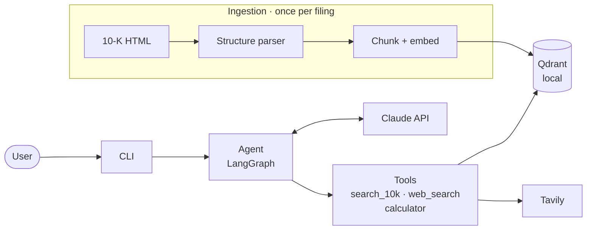
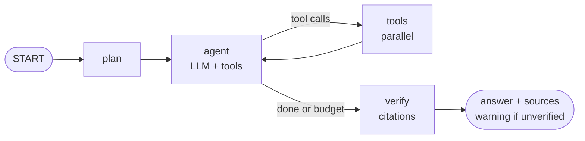

# Financial Research Agent — High-Level Design

**Author:** Andrei Bresler · **Version:** 1.2 · **Date:** 2026-10-26 · **Status:** Draft

## 1. Summary

A command-line research agent that answers questions about Apple Inc. from its fiscal 2025 Form 10-K and live web data. For each question it shows a plan, runs tools in parallel, computes numbers in code, and cites every claim: 10-K section and page, or web URL and date.

Principles: **grounded** (every number cites the filing, a web result or a calculation; code renders the sources and flags uncited claims), **structure-aware** (indexed by Item, risk factor, table and page), **transparent** (the plan and tool calls stream to the user) and **production-shaped** (model, vector store and checkpointer are configuration, so §8 extends this design rather than replacing it).

## 2. Scope and Assumptions

In scope: the Document QA and web search tools, the agent, the CLI, both required queries and all four bonuses. Non-goals: web UI, multiple companies, authentication and deployment (see §8).

|Topic|Assumption|
|---|---|
|Source|Apple 10-K for the fiscal year ended Sep 27, 2025; a newer filing is re-ingested.|
|"Top N risk factors"|The 10-K does not rank risks; the agent uses Item 1A order and says so.|
|"Current" data|Latest web data, cited with URL, retrieval date and period; not reconciled to filings.|
|Figures|Answers state units (the filing's, mostly millions) and each figure's fiscal period: Apple's year ends in September, Microsoft's in June.|

## 3. Architecture

Ingestion runs once per filing and writes a local index plus a manifest (document hash, embedding model). At query time the CLI hands each question to a LangGraph agent, which reasons with Claude and calls three tools.

**CLI:** an interactive REPL, or one-shot with `python src/main.py "question"`. It streams the plan, each tool call (for example `[search_10k] Item 1A, by position`) and the cited answer; `--verbose` adds the full trace.

**Key choices:** a custom LangGraph `StateGraph`, so plan and verify are explicit, testable nodes; a targeted BeautifulSoup parser, because 10-K structure lives in styling rather than tags and generic loaders lose it; Qdrant local mode with FastEmbed (`bge-small` + BM25) for hybrid search with no server or GPU; `simpleeval`, because LLMs are unreliable at arithmetic and `eval` is unsafe; Claude via `init_chat_model`, so the provider and pinned model version are configuration. Also: Tavily, Pydantic v2, pydantic-settings, structlog, pytest.

## 4. Agent

- **plan:** a structured plan (steps and tools), streamed to the user.
- **agent ⇄ tools:** the LLM picks tools; `ToolNode` runs them in parallel and stores each result in an evidence registry under a citation ID: `D` 10-K, `W` web, `C` calculation.
- **verify (code, not LLM):** every marker must resolve to this run's evidence; every paragraph and bullet must carry a marker, as must every sentence with a number. Failures appear as a warning. This proves traceability, not correctness; evaluation covers correctness (§7, §8).
- **Limits and state:** a step budget and per-call timeouts; at the limit, the agent answers with what it has and lists the gaps. State is typed (messages, plan, evidence, step count); `InMemorySaver` keeps the conversation for follow-up questions.

|Tool|Input|Use for|Returns|
|---|---|---|---|
|`search_10k` (Document QA)|query, section?, order_by, k|Risks, strategy, explanations, reported figures|Passages with ID, section path, page|
|`web_search`|query|Market data, competitors, post-filing events|Title, URL, date, content (untrusted)|
|`calculator`|expression|Every ratio, percentage or difference|Result and expression, with ID|

Document QA returns cited passages, not a generated answer: one answer, one citation scheme, no nested LLM call. Tools are typed `@tool` functions with Pydantic schemas. `prompts/` holds `system.txt` (tool-selection, citation and untrusted-content rules), `planner.txt` and `examples.txt`.

**Answer:** the model writes Markdown with inline markers, plus Assumptions and Data gaps when there are any. Code renders the Sources list from the registry, so the model never writes a page number or URL: `[D4] 10-K FY2025 › Part I › Item 1A › Macroeconomic and Industry Risks, p. 12` · `[W1] title, URL, retrieved 2026-10-23` · `[C1] R&D ÷ net sales × 100`.

## 5. Information Flow

Required query 2: _"How does Apple's gross margin compare to Microsoft's current gross margin, and what reasons does Apple cite for any margin pressure?"_

1. **plan:** Apple's margin and its drivers (10-K), Microsoft's latest margin (web), then compare.
2. **One agent step, three parallel calls:** `search_10k` Item 7 gross margin · `search_10k` Item 1A margin risks · `web_search` Microsoft gross margin, latest period.
3. **calculator:** both margin percentages and the difference in points.
4. **answer → verify → sources rendered.**

Query 1 follows the same pattern: `search_10k` on Item 1A by position, the R&D and net sales figures, then the calculator.

## 6. Document QA: Handling the 10-K

The parser finds Part and Item headings, splits Item 1A into individual risk factors, converts tables to Markdown and maps every block to its page from the page footers.

|Consideration|Design|
|---|---|
|Tables vs. text|Markdown chunks with headers; split only by rows, header repeated.|
|Section context|Section path (Part › Item › heading) stored and prefixed for embedding.|
|Chunk size|One risk factor or subsection; ≤ 400 tokens (embedding limit 512).|
|Chunk relationships|Path and position stored; siblings and neighbors via filter and order.|
|Cross-references|References like "Note 5" resolved at ingestion, followed one hop.|
|Entity relationships|Region and product tables kept whole; rows and columns stay aligned.|
|Narrative to table|Table chunks carry their intro paragraph; a section filter returns both.|
|Multi-hop metadata|Path, position, pages and references chain passage → section → table.|

**Search:** hybrid dense + sparse retrieval with RRF fusion, filtered by section and chunk type, ordered by relevance or document position. **Not found:** RRF scores are rank-based, so a dense-similarity threshold decides when to report "no relevant content".

## 7. Reliability, Security and Quality

Tool errors return to the model as typed tool messages, not exceptions, so the agent can adapt.

|Situation|Behavior|
|---|---|
|LLM rate limit or error|Retry with backoff, then a clear error.|
|Tavily unavailable|Answer the 10-K part; list the web part under Data gaps.|
|Nothing found in the 10-K|Say the information is not in the filing.|
|Invalid tool arguments|The schema error goes back to the model, which corrects the call.|
|Index missing or mismatched|The CLI refuses to start (manifest check) and prints the ingest command.|

- **Security:** web content is wrapped as untrusted and its instructions are ignored; all tools are read-only, so injected text cannot cause side effects. Inputs are public, so a public LLM API is acceptable for the demo. Keys come only from the environment and are never logged; the calculator is arithmetic-only; input and tool-output sizes are capped.
- **Tests:** unit (parser, retrieval filters, verifier, calculator); graph tests with scripted fake models (normal, tool-failure and budget paths, no API keys); integration tests for both queries (tools called, R&D ≈ 8.3% of net sales, gross margin ≈ 46.9%, citations resolve).
- **Retrieval eval:** about 15 questions with their expected 10-K section, scored as hit@5; re-run after any parsing, chunking or embedding change.
- **Observability:** a structured log per node and tool call (run ID, latency, tokens, outcome); optional LangSmith tracing.

## 8. From Demo to Production

|Area|Demo|Production|
|---|---|---|
|LLM access|Public API|Private endpoint (e.g. Bedrock) behind a model gateway: quotas, fallback, cost|
|Serving|CLI|FastAPI or LangGraph Server on Kubernetes; SSO (OIDC), role-based access|
|Tools|In-process|MCP servers behind a tool gateway, reusable by other agents|
|State|In memory|`PostgresSaver`, shared across replicas|
|Retrieval|Qdrant local|Qdrant cluster or the bank's standard store; reranker; exact XBRL figures|
|Ingestion|CLI command|Scheduled pipeline: EDGAR poller → queue → workers|
|Quality|Tests, retrieval eval|Golden set with an LLM judge (validated on human labels) as a CI release gate|
|Security, audit|Env keys, logs|Secrets manager; PII and injection guardrails; immutable audit; OpenTelemetry|

## 9. Requirements Traceability

Document QA §6 · web search and calculator §4 · tool choice, ordering and combining §4–5 · failures §7 · citations §4 · CLI §3 · prompts §4 · required queries §5, §7 · bonuses: tables §6, page citations §4 and §6, planning §4, cross-references §6 · README questions: tool registration §4, tool choice §4, information flow §5, prompt location §4.